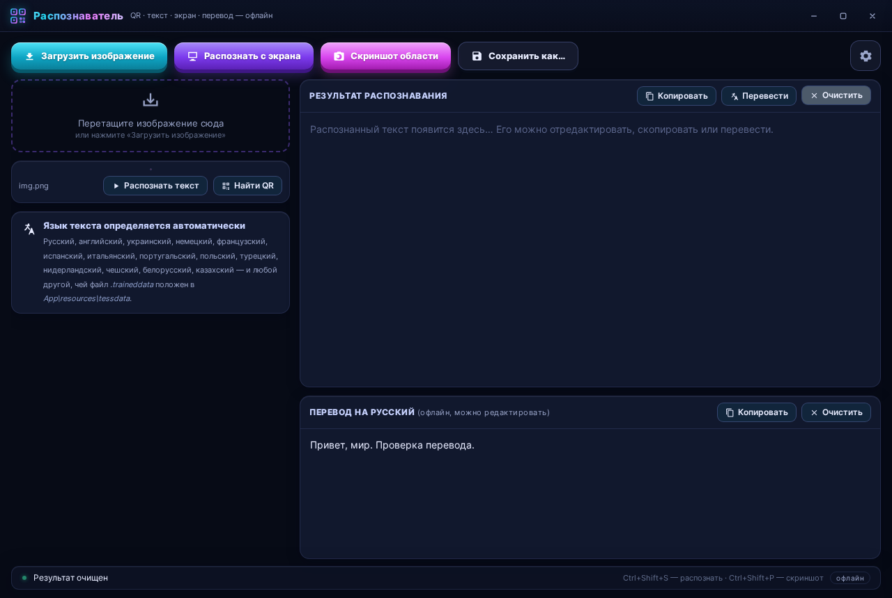
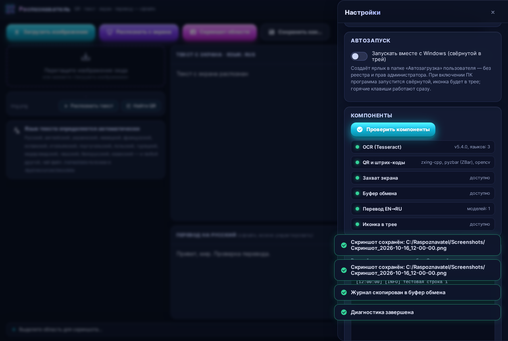

# Распознаватель 2.7.0 (бета)

Офлайн-приложение для распознавания QR-кодов, текста с изображений и экрана, а также перевода.

> **Статус: бета-версия 2.7.0.** Основные функции работают; отдельные сценарии ещё проверяются.

## Скриншоты





## Состав репозитория

- `main.py`, `api.py`, `ocr.py`, `translator.py` и остальные модули приложения;
- `ui/` — интерфейс приложения;
- `installer_custom/` — исходники кастомного установщика;
- `installer_assets/` — изображения и шрифты установщика;
- `installer_mockup/` — HTML-макет и готовый `installer_ui.html`;
- `tests/`, `tools/` — тесты и вспомогательные скрипты;
- `resources/` — ресурсы приложения, кроме крупных моделей перевода.

## Установка

Готовый установщик находится в разделе **Releases**:

`Raspoznavatel-2.7.0-Setup.exe`

Размер: `471 782 370 Б`  
SHA256: `21B9AE7DF9C75092E404F3E40AA4C278E242F8DE68AF06B9D37D2B8F9EEE7155`

Установщик не хранится в git-репозитории: GitHub не принимает файлы больше 100 МБ.

## Сборка

Требуется Python 3.10+.

```powershell
python -m venv .venv
.\.venv\Scripts\python.exe -m pip install -r requirements.txt
.\.venv\Scripts\python.exe -m PyInstaller --noconfirm --clean build.spec
```

Установщик собирается по инструкции в `RELEASE.md` и `installer_custom\README.md`.

## Модели перевода

Файлы `resources/argos/*.argosmodel` не включены в git из-за лимита GitHub 100 МБ на файл. Они входят в установщик; после установки лежат в `resources\argos`.

## Данные

В репозиторий не входят `Raspoznavatel_data/`, `Screenshots/`, логи, история, профиль WebView2, `.venv`, `build`, `dist` и старые сборки. В исходниках нет API-ключей и абсолютных пользовательских путей.
